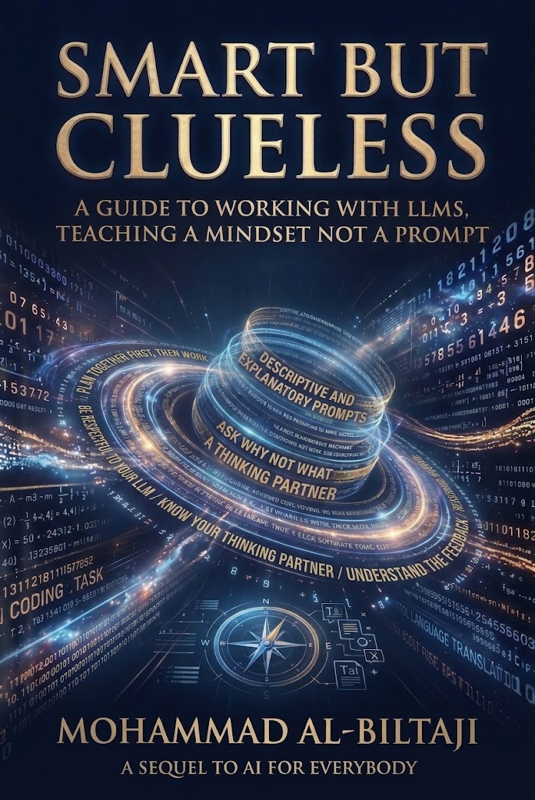

  

<h1 align="center">Smart But Clueless</h1>

<b>A guide to working with LLMs, teaching a mindset, not a prompt.</b> 
A sequel to <i>AI for Everybody</i>, by Mohammad AL-Biltaji

  <a href="Smart_But_Clueless.pdf"><b>📖 Read the booklet (PDF)</b></a>

---

## What is this?

A short, free booklet (22 pages) about using LLMs like ChatGPT, Claude or Gemini **well**.

It's not a list of magic prompts or "act as an expert" tricks. It teaches a way of thinking: an LLM is *smart* (it has read almost everything) but *clueless* (it knows nothing about you or your situation). Once you understand that, getting good results stops being a mystery.

Written in plain English, for beginners. No technical background needed.

## What's inside

| Chapter | What you'll learn |
|---|---|
| **0. Know Your Partner** | What LLMs really are, and why they need you to explain yourself |
| **1. Know Its Features** | Its memory is wide, not exact: how LLM memory actually works, and why to ask for sources |
| **2. Plan Together First** | Plan with it first, then let it do the work |
| **3. Ask Why, Not What** | Borrow the reasoning, not just the answer, plus the 80% test for using LLMs without losing your own skills |
| **4. How to Write a Proper Prompt** | No tricks: a plain-English word bank for tone, layout, slides, design and audience |
| **5. Personal Notes** | Being respectful to your LLM, and asking for feedback instead of attacks |

Every chapter follows the same simple pattern: the idea, a **wrong way** and a **right way** with real example prompts, a **watch out**, and a short note before you move on.

## Who is it for?

- Students who use LLMs for studying and assignments
- Teachers and professionals who want better results at work
- Anyone who has felt that an LLM "didn't get it"

If you're new to AI in general, start with *AI for Everybody* (especially Chapter 4, on LLMs), then read this one.

## Feedback

Comments, reviews and suggestions are welcome:
**biltajimohammad@gmail.com**, or open an [issue](../../issues) on this repo.

## License

[CC BY-NC 4.0](LICENSE): free to share, translate and adapt with credit. Not for sale.
